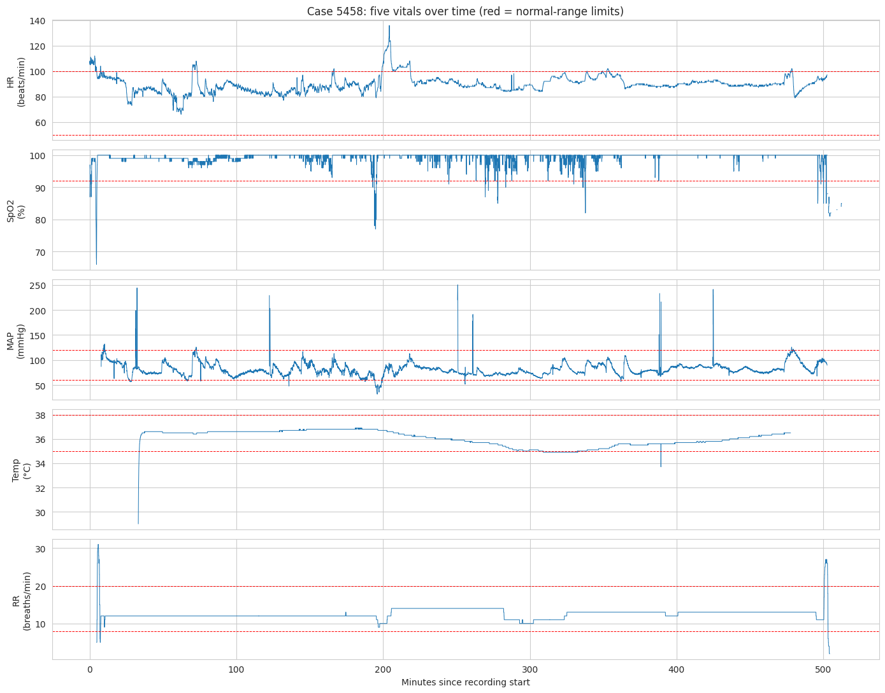

# Abnormal Patterns in Continuous Patient Monitoring

Separating **sensor artifacts** from **real physiological events** in multi-vital monitor data (VitalDB).

## Problem statement
Bedside monitors record vital signs every second, but a large share of the alarms are not about the patient: a flushed arterial line, a moved probe or electrical interference creates readings that look dramatic and mean nothing. Real deterioration, on the other hand, rarely shows up in one signal alone. The aim is to flag abnormal patterns in five continuously monitored vitals and decide whether each one is probably a **sensor artifact** or a **real change in the patient**.

## Objectives
1. Explore and clean real monitor data (missing values, impossible values, outliers).
2. Understand how the five vitals behave and relate to each other, per patient and over time.
3. Build a detector that flags abnormal episodes and classifies them as artifact / real event / needs review.
4. Evaluate it against simple baselines and report its limits honestly.

## Key features
- Domain-aware cleaning: impossible values, temperature-probe warm-up, short gaps bridged per patient (no median imputation).
- IQR outliers checked against clinical ranges instead of being deleted blindly (25 % of rows would have been lost).
- Patient-specific detector (own 5-minute baseline, robust scale) with a transparent multi-vital rule.
- Evaluation on held-out patients with injected ground truth, plus Isolation-Forest and clinical-threshold baselines and a threshold-sensitivity study.

## Dataset
**VitalDB** – intra-operative monitor data from Seoul National University Hospital (Lee et al., *Scientific Data*, 2022). Open access: https://vitaldb.net · https://physionet.org/content/vitaldb/1.0.0/
Sample used: 30 random surgical cases that have all five tracks, 199,876 readings at 2-second resolution (seed 42).

| Vital | VitalDB track | Unit |
|---|---|---|
| HR | `Solar8000/HR` | beats/min |
| SpO₂ | `Solar8000/PLETH_SPO2` | % |
| MAP | `Solar8000/ART_MBP` | mmHg |
| Temp | `Solar8000/BT` | °C |
| RR | `Solar8000/RR_CO2` | breaths/min |

## Technologies
Python · pandas · NumPy · SciPy · scikit-learn · Matplotlib · Seaborn · `vitaldb` package · Google Colab

## Methodology
1. **Load** – 30 random cases, five tracks, 2 s grid, joined with clinical table (sex, department, ASA).
2. **Clean** – physiologically impossible values → missing (18,153 readings); first 10 min of temperature → missing (probe warm-up); gaps ≤ 10 s (≤ 120 s for temperature) bridged within each patient; complete-case table for statistics.
3. **EDA** – missing-value patterns, IQR outliers vs clinical ranges, distributions, correlations (Pearson, Spearman, within-patient), time-series views.
4. **Detect** (`src/detect.py`)
   - baseline = median of the patient's previous 5 minutes, per vital;
   - flag a reading when |reading − baseline| > K × max(floor, patient-specific robust scale), K = 4;
   - group consecutive flags into episodes;
   - **real event** if another vital is flagged within ±30 s; **artifact** if isolated and ≤ 30 s; otherwise **review**.
5. **Evaluate** (`src/evaluate.py`) – VitalDB has no artifact labels, so known artifacts (short single-vital spikes) and known events (hypotension, hypoxaemia, hypertension patterns) are injected into held-out patients (70/30 patient split). Baselines: clinical thresholds, Isolation Forest (fitted on the training patients).

## Results

### Data cleaning and EDA (from `notebooks/01_EDA_VitalDB.ipynb`)
| Finding | Value |
|---|---|
| Rows loaded → complete cases | 199,876 → 139,501 (70 %) |
| Missing before treatment | Temp 23.4 %, MAP 9.0 %, RR 9.0 %, HR 5.9 %, SpO₂ 4.5 % |
| Impossible readings set to missing | 18,153 (mostly MAP < 20 mmHg: arterial-line flushes/zeroing) |
| IQR outliers that are clinically abnormal | HR, Temp, RR 100 %, MAP 94 %, **SpO₂ only 1.1 %**, overall 33 % |
| Most skewed vital | SpO₂ (skewness −11.8): sits at 100 % almost always |
| Vital outside normal range most often | HR (10.0 % of the time) |
| Strongest correlation | HR–RR, r = 0.22 overall, 0.12 within patient |

Correlations between vitals are weak, so single-vital rules cannot tell artifacts from events; the detector therefore uses *agreement between vitals*.



### Detection and evaluation (from `notebooks/02_Detection_VitalDB.ipynb`)
> **TODO – fill in after running notebook 2 in Colab** (numbers are in `results/metrics.json`).

| Metric | Value |
|---|---|
| Episodes found / per recorded hour | TODO |
| Share artifact / real event / review | TODO |
| Injected artifacts detected / correctly named | TODO |
| Injected events detected / correctly named | TODO |
| Row-level F1: our detector / Isolation Forest / clinical thresholds | TODO |

Figures are written to `results/figures/`.

### Limitations / status of planned features
- Evaluation uses **injected** (simulated) artifacts and events, not clinician labels; naturally occurring anomalies count as false alarms, so row-level precision is conservative.
- A common artifact source (e.g. electrocautery) can disturb several vitals at once and look like a real event.
- The 5-minute baseline adapts slowly after a genuine level shift.
- No dashboard/UI was built; the deliverable is notebooks + scripts + results.


## How to run
- **Google Colab (easiest):** upload and run `notebooks/01_EDA_VitalDB.ipynb`, then `notebooks/02_Detection_VitalDB.ipynb` (Runtime → Run all). Notebook 2 downloads a `results.zip` – unzip it into `results/`.
- **Command line:** `python src/run_pipeline.py` (add `--n-cases 60` for more patients). Needs internet for VitalDB.
- **Test without internet:** `python src/run_pipeline.py --demo` runs the code on *simulated* data. Those numbers are not results.

## Project structure
```
├── README.md
├── requirements.txt
├── data/        (how to get the data – nothing stored)
├── notebooks/   01_EDA_VitalDB.ipynb, 02_Detection_VitalDB.ipynb
├── src/         preprocess.py, detect.py, evaluate.py, plots.py, synthetic.py, run_pipeline.py
├── results/     metrics.json, episodes.csv, figures/, eda/
├── models/      (rule-based detector – nothing to save)
└── poster/      final poster
```


## References
Lee H.-C. et al. VitalDB, a high-fidelity multi-parameter vital signs database in surgical patients. *Scientific Data* 9, 279 (2022).
